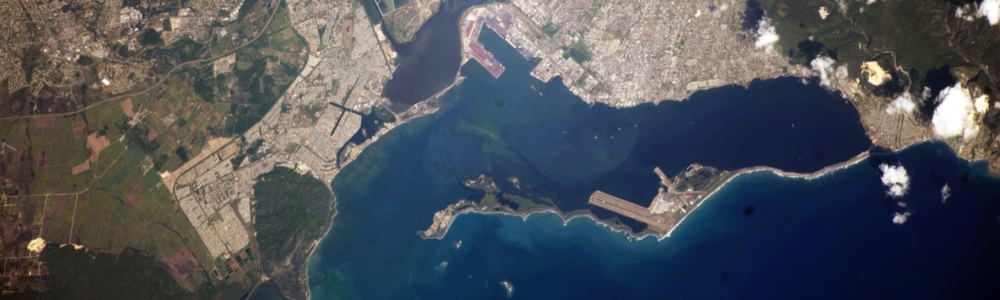

<h1 align="center">Hi, I’m Javel</h1>

<strong>Backend developer from Jamaica 🇯🇲</strong>

  I write Go and Rust and use my homelab to experiment with Linux and Kubernetes.

  
   
  Kingston from orbit · <a href="https://eol.jsc.nasa.gov/SearchPhotos/photo.pl?frame=35461&amp;mission=ISS022&amp;roll=E">NASA / ISS Expedition 22</a>

<h2>Languages &amp; tools</h2>

  
  
  
  
  
  
  

<h2>GitHub activity</h2>

  <picture>
    <source media="(prefers-color-scheme: dark)" srcset="https://streak-stats.demolab.com/?user=j4v3l&amp;theme=github-dark-blue&amp;hide_border=true&amp;background=00000000&amp;ring=87D7DE&amp;fire=87D7DE&amp;currStreakLabel=87D7DE&amp;disable_animations=true">
    
  </picture>

